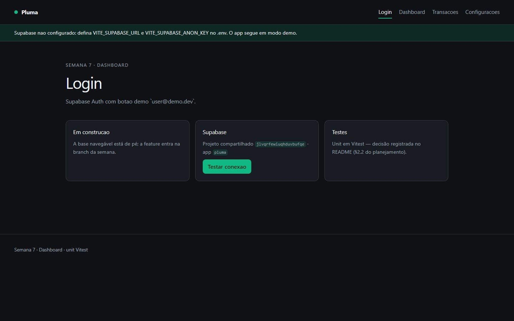
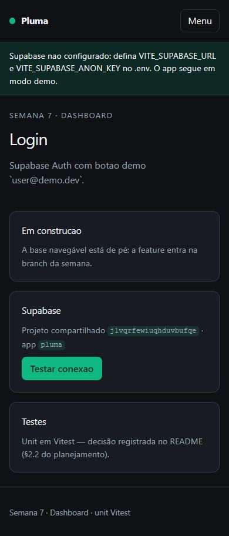
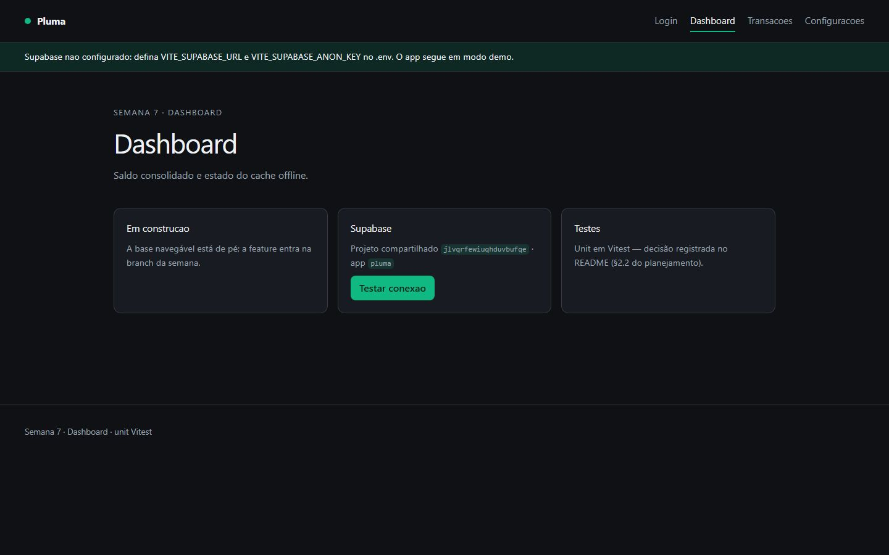
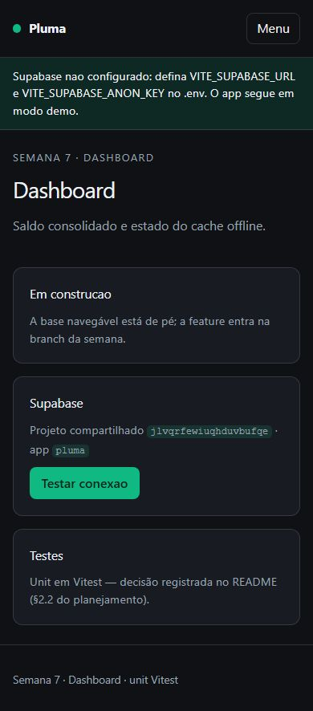
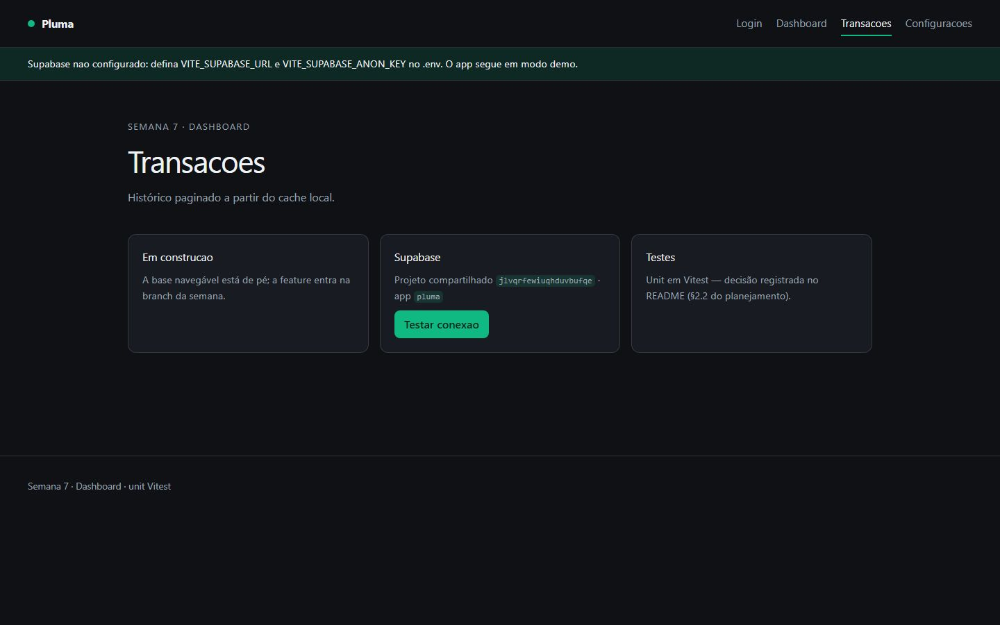
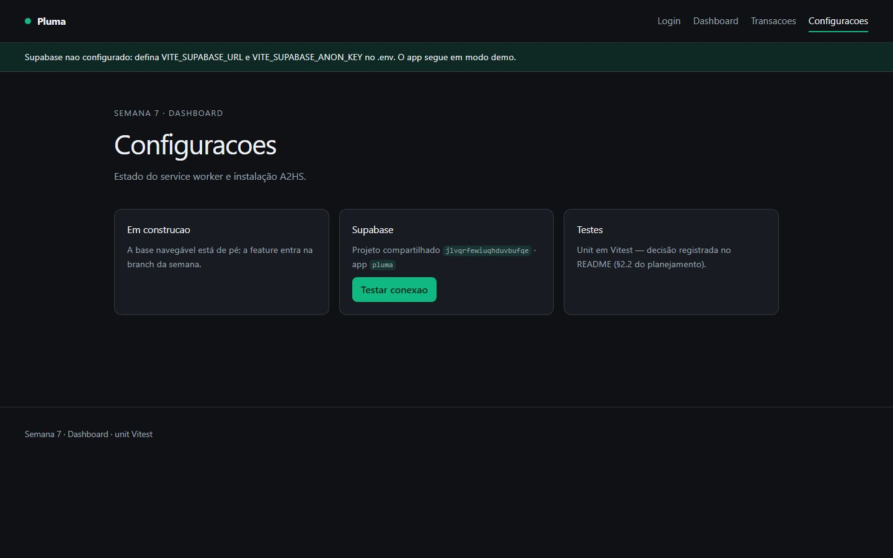
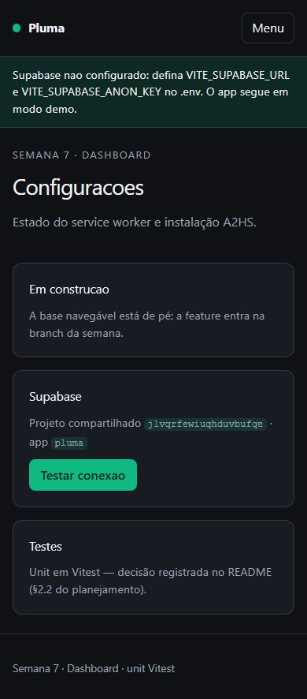

# Pluma — App financeiro offline-first (PWA)


> PWA financeiro **offline-first**: Service Worker, cache, fila de sincronização e instalação (A2HS).
> Pilar **Dashboard** · Semanas 7 e 10 do roadmap · Milestone `m1-pluma, m2-perf` · Demo pública no GitHub Pages.

---

## Screenshots do Produto

### Login
| Desktop | Mobile |
|---------|--------|
|  |  |

### Dashboard
| Desktop | Mobile |
|---------|--------|
|  |  |

### Transações
| Desktop | Mobile |
|---------|--------|
|  |  |

### Configurações
| Desktop | Mobile |
|---------|--------|
|  |  |

> **Baselines:** 8 screenshots (4 telas × desktop/mobile) versionadas em `docs/screenshots/`, geradas por `e2e/screenshots.spec.ts`. Regerar com `npm run e2e:screenshots`.

---

## Documentação

| Arquivo | Descrição |
|---------|-----------|
| [`docs/pluma-pwa-case.md`](./docs/pluma-pwa-case.md) | Case study: contexto, desafio, solução, métricas e "o que aprendi" |
| [`docs/a11y/relatorio-axe.json`](./docs/a11y/relatorio-axe.json) | Relatório de acessibilidade (axe) das 4 telas |
| [`docs/clarity-integracao.md`](./docs/clarity-integracao.md) | Integração do Microsoft Clarity (mapa de calor) |
| [`docs/manter-online.md`](./docs/manter-online.md) | Estratégia zero-standby / zero cold start |
| [`supabase/README.md`](./supabase/README.md) | Schema, RLS, seed e decisões de segurança |

---

## Setup Rápido

```bash
npm install          # o postinstall roda `npm run env` e gera o ambiente
cp .env.example .env # (opcional) preencha VITE_SUPABASE_ANON_KEY
npm start            # ng serve → http://localhost:4200
```

Sem backend o app **funciona**: a ausência das chaves do Supabase cai em **modo demo** — o app sobe,
navega e exibe um aviso. Nenhuma tela quebra por falta de credencial.

---

## Comandos Principais

| Comando | Descrição |
|---------|-----------|
| `npm start` | Servidor de desenvolvimento (`ng serve`) |
| `npm run build` | Build de produção (`ng build`) |
| `npm run lint` | ESLint + angular-eslint |
| `npm test` | Testes unitários (Vitest, watch) |
| `npm run test:ci` | Testes unitários + cobertura (CI) |
| `npm run e2e` | Playwright (a11y + screenshots) |
| `npm run e2e:a11y` | Varredura de acessibilidade (gera relatório axe) |
| `npm run e2e:screenshots` | Regenera os prints do README |
| `npm run analyze` | Análise de bundle (`ng build --stats-json`) |
| `npm run env` | Gera `src/environments/ambiente.local.ts` a partir do `.env` |

> **Porta dedicada:** o Playwright sobe o app automaticamente, mas se a 4200 estiver em uso por
> outra sessão aponte para uma porta livre:
> `npx ng serve --port 4330` + `E2E_BASE_URL=http://localhost:4330 npm run e2e`.

---

## Telas Implementadas

| Tela | Rota | Conteúdo |
|------|------|----------|
| Login | `/login` | Shell + health-check do Supabase compartilhado (demo `user@demo.dev`) |
| Dashboard | `/dashboard` | Saldo consolidado e estado do cache offline |
| Transações | `/transacoes` | Histórico paginado a partir do cache local |
| Configurações | `/configuracoes` | Estado do Service Worker e instalação A2HS |

> `''` redireciona para `/login`; qualquer rota desconhecida (`**`) também. Este é o **scaffold
> navegável** — a lógica de saldo, fila offline e Service Worker entra na branch da Semana 7/10.

---

## Qualidade & Performance

| Métrica | Resultado |
|---------|-----------|
| **Unit tests (Vitest)** | 6/6 passando |
| **Cobertura** | 76,7% statements · 69,0% branches · 78,6% lines |
| **E2E (Playwright)** | 9/9 passando (axe + screenshots) |
| **Acessibilidade (axe)** | 0 violações graves/críticas nas 4 telas |
| **Lighthouse** | Performance **100** · A11y **100** · Best Practices **100** · SEO **100** |
| **ESLint** | 0 erros · 0 warnings |
| **Bundle inicial** | 472,8 kB (≈115,0 kB transfer) |
| **Responsivo** | mobile (390) / desktop (1440) |

> O build emite um **aviso de budget** pré-existente: o bundle inicial (472,8 kB) passa do limite de
> aviso de 350 kB configurado em `angular.json`. O limite de erro (500 kB) não é atingido. A quebra
> por rota (code splitting) fica para a fase de performance do roadmap (Semana 10).

---

## Acessibilidade

Varredura automatizada com `@axe-core/playwright` (tags WCAG 2.0/2.1 A+AA) nas quatro telas —
**zero violações** graves ou críticas (15 verificações passando por tela).

- **Skip link** "Pular para o conteúdo" no topo de todas as páginas (`href="#conteudo"`).
- **Foco visível** em `--acento` (`:focus-visible`), contraste de texto acima de 4,5:1 no tema escuro.
- **Navegação mobile** com botão `aria-expanded`/`aria-controls` e menu que abre/fecha por teclado.
- **`prefers-reduced-motion`** zera animações e transições; `lang="pt-BR"` no documento.
- Relatório versionado em [`docs/a11y/relatorio-axe.json`](./docs/a11y/relatorio-axe.json). Reproduzir: `npm run e2e:a11y`.

---

## Design — decisão e intenção

> Cada escolha tem um "para quê" — nada é decorativo solto.

### Conceito

**"Pluma"** é um app financeiro que trata dinheiro como algo leve e claro: números tabulares, contraste
calmo e uma **única cor de ação**. O tema escuro é padrão (`color-scheme: dark`) porque finanças
pessoais são consultadas à noite, no celular.

### Identidade visual

| Token | Valor | Para quê |
|-------|-------|----------|
| `--fundo` `#0f1115` | quase preto azulado | Palco escuro, descansa a vista em uso noturno |
| `--superficie` `#181b21` | cinza-elevação | Cartões que se destacam do fundo sem borda dura |
| `--texto` `#eef1f5` | branco quebrado | Leitura confortável — sem branco puro |
| `--tenue` `#9aa3af` | cinza-médio | Metadados e nav inativa: hierarquia sem gritar (contraste AA) |
| `--acento` `#10b981` | esmeralda | **Ação e estado positivo** — botões, foco, links ativos |
| `--acento-contraste` `#06281d` | verde profundo | Texto sobre o esmeralda (skip link, botão) |

- **Tipografia:** `Inter` (fallback `system-ui`/`Segoe UI`), em que os números usam
  `font-variant-numeric: tabular-nums` para que o **saldo não "dance"** ao atualizar.
- **Estilização:** Tailwind CSS 4 via PostCSS, com tokens CSS próprios em `src/styles.css`.
- **Formas e consistência:** cantos arredondados, bordas por `color-mix` a 14% do texto (borda
  "de luz", não de tinta), foco com `outline` de 2px + offset.

### Decisões de produto

| Peça | Decisão | Intenção |
|------|---------|----------|
| Tema escuro | `color-scheme: dark` + tokens | Uso noturno no celular como cenário primário |
| Modo demo | Sem `.env`, o app sobe e avisa (`role="status"`) | Entrevistador/testador roda sem configurar Supabase |
| Health-check | Botão "Testar conexão" nas telas | Prova viva de que o backend compartilhado responde |
| Offline-first | Service Worker + fila (Semana 10) | Um lançamento feito offline não se perde |
| Soft delete | `deleted_at` em vez de delete físico | Evita ressuscitar conta excluída no próximo push |

---

## Estrutura do Projeto

```text
src/
├─ app/
│  ├─ core/                 # config do ambiente + SupabaseService (cliente único, modo demo)
│  ├─ pages/                # login, dashboard, transacoes, configuracoes
│  ├─ app.ts / app.html     # shell: skip link, header/nav, main, footer
│  └─ app.routes.ts         # roteamento ('' → login, ** → login)
├─ environments/            # ambiente.local.ts é GERADO (gitignored)
└─ index.html
e2e/                        # Playwright: acessibilidade (axe), screenshots, apoio/sessao.ts
docs/                       # case study, a11y, screenshots, runbooks
supabase/                   # migrations (schema + RLS), seed e README
.github/workflows/          # CI, Deploy (Pages), bots de teste/erro/humano
bots/                       # bots locais: analise-erros, humano
scripts/gerar-ambiente.mjs  # codegen do ambiente (postinstall/prestart/prebuild/pretest)
```

---

## Stack

| Responsabilidade | Tecnologia |
|------------------|------------|
| Framework | Angular 22 (standalone, signals, zoneless) |
| Linguagem | TypeScript 6.0 |
| Estilização | Tailwind CSS 4 + tokens CSS |
| Backend/Dados | Supabase (Postgres + Auth + RLS) — projeto compartilhado `angular-portfolio` |
| Offline | Service Worker + Workbox · IndexedDB (fila) — Semana 10 |
| Testes | Vitest (unit) · Playwright + axe (E2E/a11y) |
| Qualidade | ESLint + angular-eslint · Lighthouse CI |
| Deploy | GitHub Pages (site estático) |

---

## Decisão de teste: Vitest

> Cada repo do roadmap alterna Karma/Vitest de propósito: agnóstico de ferramenta, escolha por contexto.

Neste repo o contexto é **lógica de dashboard**: regra de categorização, cálculo de saldo,
agrupamento por mês e a fila de sync offline. É lógica pura e determinística — não há animação para
medir nem WebGL para renderizar.

- **Ciclo de feedback curto:** roda em Node puro, sem browser, mais rápido e estável que o Karma.
- **Cobertura V8 embutida:** statements/branches/lines nativos, sem instrumentador extra.
- **Nativo ESM + TypeScript:** mesmos specs em `describe/it/expect` que a equipe já conhece.

O que o unit **não** alcança é o Service Worker — a superfície de risco real da Semana 7/10. Isso é
coberto por E2E com Playwright em contexto offline (`context.setOffline(true)`), testando o
comportamento, não a implementação.

---

## Branches & Workflow Git

```text
main      → produção (build estático; push dispara deploy no GitHub Pages)
homolog   → validação/release de PRs (staging)
develop   → integração diária (merges das feat/*)
feature   → feat/<assunto> + PR para develop
```

- **Commits:** `feat:`, `fix:`, `test:`, `docs:`, `design:`, `ops:`, `backend:` (Conventional Commits)
- **PRs:** via pull request template; revisados e mergeados por milestone
- **main:** protegida — merge somente via PR
- Rastreabilidade com issues, labels (`feat/test/design/ops/backend`) e milestones

---

## Bots (estação local + CI)

Os bots vivem em `bots/` e rodam localmente e no GitHub Actions. Cada um olha uma dimensão que o
outro não enxerga.

| Bot | O que faz | Como roda localmente |
|-----|-----------|----------------------|
| **Humano** (`bots/humano/navegacao-humana.mjs`) | Navega com comportamento de pessoa real (cliques com atraso, scroll gradual) e valida resposta/erros de página. | `BOT_URL=http://localhost:4200 node bots/humano/navegacao-humana.mjs` |
| **Analisador de erros** (`bots/analise-erros/analisador.mjs`) | Lê logs de build/e2e/CI, classifica por severidade e aponta padrões repetidos. | `node bots/analise-erros/analisador.mjs` |
| **CI + Lighthouse** | `npm ci` → lint → build → Vitest → Playwright + axe → Lighthouse. | `npm run build` + `npx lhci autorun` |

---

## Microsoft Clarity (mapa de calor)

Integração **condicional**: o snippet só é injetado quando `CLARITY_PROJECT_ID` está definida, via
codegen do ambiente. Grava mapa de calor, scroll, cliques e sessões reais — a "comunicação" que fecha
o ciclo dos bots. Ver [`docs/clarity-integracao.md`](./docs/clarity-integracao.md).

---

## Deploy

- **GitHub Pages** (projeto público): https://zecki1.github.io/angular-pluma-pwa/
  Workflow [`.github/workflows/deploy-pages.yaml`](./.github/workflows/deploy-pages.yaml) — build com
  `--base-href=/angular-pluma-pwa/` + fallback SPA (`index.html` → `404.html`) + `.nojekyll`.
- **Política do workspace:** projetos públicos → GitHub Pages; projetos privados → Vercel
  (config em `vercel.json`).
- Estratégia zero-standby documentada em [`docs/manter-online.md`](./docs/manter-online.md).

---

## Ambiente (Supabase)

Variáveis em `.env` (nunca commitadas):

```
VITE_SUPABASE_URL=https://jlvqrfewiuqhduvbufqe.supabase.co
VITE_SUPABASE_ANON_KEY=
VITE_SUPABASE_PROJECT_SLUG=pluma
VITE_ROLE=demo
CLARITY_PROJECT_ID=
```

A anon key pode ir no bundle (o **RLS** é a proteção); a `service_role` nunca entra no front nem no
repo. Schema, RLS e seed em [`supabase/README.md`](./supabase/README.md).

---

## Links Úteis

- **Produção (GitHub Pages):** https://zecki1.github.io/angular-pluma-pwa/
- **Repositório:** https://github.com/zecki1/angular-pluma-pwa
- **Roadmap do portfólio:** `planejamento-projetos.md` (Semanas 7 e 10 — Pluma)

---

## Licença

MIT — ver [`LICENSE`](./LICENSE).
